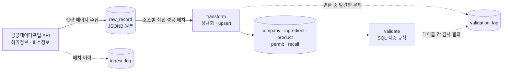

# mfds-drug-pipeline

식품의약품안전처 공공 API의 의약품 허가정보와 회수·판매중지 정보를 수집해 정규화하고, 데이터 품질 문제를 탐지해 테이블에 기록하는 배치 파이프라인.

같은 제품의 허가 갱신 이력과 회수 이력을 한 번에 조회할 수 있게 만드는 것이 목적이다. 공공 API 원본은 그대로 쓰기 어렵다. 같은 회사가 식별자 여러 개로 흩어져 있고, 허가를 갱신하면 품목 코드가 새로 발급되며, 결측 표기와 구분자 규칙이 필드마다 다르다. 이 프로젝트는 그런 문제를 실데이터에서 찾아내고, 각각을 어떻게 판단했는지 코드와 문서에 남기는 데 중점을 둔다.

| 항목 | 값 |
|---|---|
| 허가정보 | 42,980건 → 제품 42,885개로 정규화 |
| 회수정보 | 958건 → 954건 (원천 중복 합침) |
| 실행 규모 | 수집 API 호출 약 440회(페이지당 100건), 변환·검증 약 6초 |
| 검증 규칙 | 변환 중 4종 + 변환 후 4종, 결과는 `validation_log`에 기록 |
| 단위 테스트 | 48개, 대부분 실데이터에서 발견한 사례 |

## 구조



수집(`src/load`)은 API 응답을 가공 없이 `raw_record`에 쌓고, 변환(`src/transform`)은 소스별로 가장 최근에 성공한 배치만 읽어 정규화 테이블에 반영하며, 검증(`src/validate`)은 변환이 끝난 테이블을 검사한다. `src/pipeline.py`가 세 단계를 순서대로 실행한다.

## 설계 판단

**원본을 먼저 보관한다.** 정제 규칙은 데이터를 보면서 계속 바뀐다. 원본이 없으면 규칙을 고칠 때마다 API를 전량 다시 호출해야 하는데, 일일 호출 한도가 있는 공공 API에서는 비용이 크다. 실제로 이 프로젝트에서 제품 키 규칙과 성분 분해 규칙을 고칠 때 재수집 없이 변환만 다시 실행했다. 두 소스는 `source` 컬럼으로 구분하는 단일 테이블에 JSONB로 저장해, 소스마다 필드 구성이 달라도 DDL이 바뀌지 않는다.

**몇 번을 실행해도 결과가 같다.** 마스터와 허가·회수는 자연키 기준 upsert로, 허가에 딸린 성분·EDI 코드는 기존 행을 지우고 다시 넣는 방식으로 반영한다. 규칙이 바뀌어 어떤 허가에도 연결되지 않게 된 제품과 성분은 변환 마지막에 정리한다. 검증 결과도 같은 배치를 다시 검사하면 이전 기록을 지우고 새로 쓴다. 재실행할 때마다 문제 건수가 불어나면 품질 기록을 믿을 수 없기 때문이다.

**실패는 실패한 대로 남긴다.** 수집 이력은 적재 트랜잭션과 분리된 autocommit 커넥션으로 기록한다. 같은 트랜잭션에 두면 적재가 실패해 롤백될 때 실패했다는 기록까지 함께 사라진다. 파이프라인 단계도 트랜잭션을 나눠, 검증이 실패해도 변환 결과는 남는다.

**값 하나 때문에 배치 전체를 멈추지 않는다.** 날짜 형식이 어긋난 값은 그 값만 비우고 `error`로 기록한 뒤 진행한다. 대신 자연키에 들어가는 값처럼 비울 수 없는 경우는 그 행을 건너뛰고 기록한다.

**애매하면 합치지 않는다.** 잘못 쪼개진 제품은 나중에 합칠 수 있지만, 잘못 합쳐진 제품은 어느 허가가 어느 제품이었는지 되돌릴 근거가 남지 않는다. 같은 제품인지 자동으로 판단할 수 없는 경우는 `review_needed`로 표시하고 사람이 볼 수 있게 기록한다.

**지금 깨끗한 규칙도 매 배치 검사한다.** 현재 위반이 0건인 규칙도 둔다. 이번 배치가 깨끗하다는 것은 이번 배치의 사실일 뿐이다. 실제로 "원본 성분 수와 분해한 성분 수가 같아야 한다"는 규칙은 첫 실행에서 244건을 잡아냈고, 원인은 성분명 안의 구분자를 잘못 나눈 파싱 버그였다.

## 데이터에서 발견한 것

자세한 근거와 확인 쿼리는 [docs/findings.md](docs/findings.md)에 있다. 여기에는 설계를 바꾼 것만 적는다.

**업체 식별자가 흩어져 있다.** 같은 데이터에서 `ENTP_SEQ`는 800개, 사업자등록번호는 602개다. 사업자등록번호를 업체 통합 키로 쓴다.

**허가를 갱신하면 품목 코드가 바뀐다.** `ITEM_SEQ`로는 같은 제품을 묶을 수 없어, 제품명을 정규화(NFKC, 단위 표기 통일, 공백 제거)하고 사업자번호를 붙여 제품 키로 쓴다.

**제품명의 괄호를 버리면 다른 제품이 합쳐진다.** 처음에는 성분 나열 같은 괄호를 버렸는데, 샘플을 확인하니 `(바이알)`, `(사향대체물질함유)`처럼 용기나 처방이 다른 제품이 하나로 합쳐져 있었다. 규칙을 뒤집어 별칭인 `(수출명:...)`만 버리고 나머지 괄호는 모두 남겼다. 두 규칙의 결과가 달라진 46개 그룹을 전수 분류한 결과, 서로 다른 제품 30개 그룹의 과병합을 막는 대신 성분명 괄호만 달라진 갱신 15개 그룹을 별개 제품으로 남기게 됐다.

**성분명 안에도 구분자가 있다.** 성분은 `/`로 구분하지만 `Teriparatide (rDNA/ Host:E.coli ...)`나 백신 균주명 `[A/Darwin/1415/2025]`처럼 이름 안에도 `/`가 들어 있다. 괄호 안의 `/`와 뒤에 공백이 붙은 `/`를 구분자에서 제외해, 성분 수 불일치가 244건에서 67건으로 줄고 성분 마스터에 섞여 있던 조각 365개가 정리됐다.

**회수 건에는 식별자가 없다.** 품목 코드·회수일·사유를 자연키로 쓴다. 이 키로도 겹치는 행이 같은 페이지 안에 연속으로 있어, 원천이 같은 행을 여러 번 보낸 것으로 판단했다. 목록 API에 없는 제조번호로 구분되는 별개 행일 가능성이 있어, 한 행으로 합치되 원래 행 수를 보존한다.

**회수의 44%는 허가정보에 없다.** 표기 차이, 오래된 품목 누락, API 버전 차이를 차례로 확인해 기각했고, 미연결 건의 제품명이 소독용에탄올·마스크·한약재 등이라 회수 API의 품목 범위가 더 넓은 것으로 본다. 근거가 제품명뿐이라 품목 종류를 분류해 넣지는 않는다. 회수 테이블에 허가 테이블로 가는 외래키를 걸지 않고, 연결 여부는 조회할 때 판단한다.

## 스키마

| 계층 | 테이블 | 설명 |
|---|---|---|
| raw | `raw_record` | API 응답 원본. 배치마다 쌓인다 |
| 마스터 | `company` | 사업자등록번호 기준 업체 |
| | `ingredient` | 영문명 기준 성분 |
| | `product` | 정규화 키 기준 제품. `review_needed` 표시 |
| 허가 | `permit` | 허가 건. 원본 1행 = 1행 |
| | `permit_ingredient` | 허가-성분. 원본 나열 순서와 중복 보존 |
| | `permit_edi_code` | 허가-EDI 코드 |
| 회수 | `recall` | 회수 건. 원천 중복을 합친 행 수 보존 |
| 운영 | `ingest_log` | 수집 배치 이력과 건수 |
| | `validation_log` | 검증 규칙별 탐지 결과 |

전체 정의와 컬럼별 판단 근거는 [sql/schema.sql](sql/schema.sql)의 주석에 있다.

### 검증 규칙

| 규칙 | 등급 | 단계 | 현재 건수 |
|---|---|---|---|
| `REQUIRED_FIELD_MISSING` 필수값 누락 | error | 변환 | 0 |
| `VALUE_FORMAT_INVALID` 날짜·Y/N 형식 오류 | error | 변환 | 0 |
| `PRODUCT_REVIEW_NEEDED` 같은 키의 허가끼리 성분·구분이 다르거나 동시에 유효 | warning | 변환 | 17 |
| `RECALL_SOURCE_DUPLICATE` 회수 원천 중복 | info / warning | 변환 | 3 |
| `CANCEL_STATE_MISMATCH` 취소 상태와 취소일 불일치 | error | 검증 | 0 |
| `STDR_CODE_MISMATCH` 저장하지 않은 코드가 품목 코드와 다름 | warning | 검증 | 0 |
| `INGR_CNT_MISMATCH` 원본 성분 수와 분해 결과 불일치 | warning | 검증 | 67 |
| `RECALL_UNMATCHED_PERMIT` 허가정보에 없는 회수 건 | info | 검증 | 420 |

### 조회 예시

제품 단위로 허가 갱신 이력과 회수 이력을 함께 본다. 회수는 갱신 전 품목 코드에 걸려 있어도 같은 제품 아래에서 보인다.

```sql
SELECT pr.name_ko, c.name_ko AS company, p.item_seq, p.permit_date, p.cancel_name,
       r.recall_command_date, r.reason, r.is_enforced
  FROM product pr
  JOIN company c USING (company_id)
  JOIN permit p USING (product_id)
  LEFT JOIN recall r ON r.item_seq = p.item_seq
 WHERE pr.name_ko LIKE '%제품명%'
 ORDER BY p.permit_date, r.recall_command_date;
```

## 실행

공공데이터포털에서 [의약품 제품 허가정보](https://www.data.go.kr/data/15095677/openapi.do)와 [의약품 회수·판매중지 정보](https://www.data.go.kr/data/15059114/openapi.do) 활용신청이 필요하다.

```bash
cp .env.example .env                # 인증키와 DB 비밀번호 입력
docker compose up -d --wait         # PostgreSQL 16. 첫 실행 시 스키마 자동 적용

python -m venv .venv
source .venv/bin/activate
pip install -r requirements-dev.txt

python -m src.pipeline              # 수집 → 변환 → 검증
python -m src.pipeline --skip-ingest  # 저장된 raw로 변환·검증만
python -m pytest                    # 단위 테스트
```

종료 코드로 결과를 구분한다. 스케줄러가 로그를 읽지 않고도 실행 실패와 데이터 오류를 가를 수 있게 하기 위해서다.

| 코드 | 의미 |
|---|---|
| 0 | 정상 완료 |
| 1 | 실행 중 예외 |
| 2 | 실행은 끝났으나 error 등급 검증 결과가 있음 |

## 프로젝트 구조

```
src/
  config.py              환경변수 로드와 필수값 검증
  extract/api_client.py  페이지 조회, 재시도, 응답 래퍼 제거
  load/db.py             커넥션과 트랜잭션 관리
  load/raw_loader.py     raw 적재와 수집 이력 기록
  transform/normalize.py DB에 의존하지 않는 정제 함수
  transform/transform.py 정규화 테이블 반영과 변환 중 문제 기록
  validate/validate.py   테이블 단위 검증 규칙
  pipeline.py            전체 실행 진입점
sql/schema.sql           스키마와 컬럼별 판단 근거
tests/test_normalize.py  정제 규칙 단위 테스트
docs/findings.md         데이터 발견 사항과 판단 기록
```

## 한계

- 원천에서 사라진 허가·회수는 반영하지 않는다. 매 배치 전량을 수집하지만 변환이 upsert라 삭제를 감지하지 않는다.
- `raw_record`는 배치마다 계속 쌓이며 보존 기간 정책이 없다.
- 제품 키 규칙상 성분명 괄호만 달라진 갱신 15개 그룹이 별개 제품으로 남는다.
- 괄호 없이 이름 안에 `/`가 있는 성분은 잘못 나뉜다. 성분 수 검증 규칙이 warning으로 기록한다.
- `review_needed` 제품을 사람이 검토하고 결과를 반영하는 절차는 없다.
- 스케줄링은 포함하지 않는다. 종료 코드를 기준으로 cron이나 워크플로 도구에 연결할 수 있다.

## 기술

Python 3.11, PostgreSQL 16, Docker Compose, psycopg 3, tenacity, pytest

데이터 출처: 식품의약품안전처, 공공데이터포털 (이용허락범위 제한 없음)
